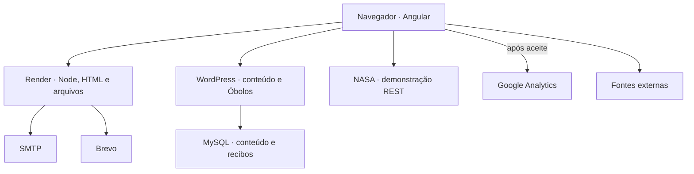

# Revisão de arquitetura do Sanaka

Revisão examinada `ec99557858356b6d91f5a93c42bebadef1be8400`, após o merge da PR #115. Leitura iniciada em 20/11/2026 e concluída em 21/11/2026. A issue #113 acompanha as correções derivadas desta revisão.

O compartilhamento de comportamento está aplicado em parte da aplicação. A revisão encontrou cópias de apresentação, regras repetidas com nomes distintos, concentrações de responsabilidades e comentários que divergem da convenção do projeto. Esses achados impedem afirmar conformidade integral de arquitetura. Uma nota numérica dependeria de critérios de avaliação e de uma revisão independente.

## Método e alcance

O inventário por AST percorreu 97 arquivos TypeScript de `src/app`, excluindo testes e fontes didáticas geradas. Identificou 38 componentes e 19 classes com `@Injectable`, incluindo as stores. A análise combinou esse inventário com leitura dos templates, estilos, consumidores responsivos, fluxos de dados e verificações existentes.

A detecção de cópias usou jscpd, com mínimo de cinco linhas e 50 tokens por bloco, nos formatos TypeScript, markup e SCSS. A leitura manual comparou também código que executa a mesma função com outra estrutura ou nomenclatura.

O inventário inicial cobre manutenção do Angular e suas fronteiras com o servidor. A ampliação para o sistema inteiro inclui Node, WordPress, banco, integrações, publicação e recuperação. Os testes existentes de segurança, HTTP e SSR entram como evidências dos contratos exercitados. A revisão estática e essas suítes têm alcance limitado sobre execução em dispositivos físicos e qualidade arquitetural.

## Inventário por área

| Área                       | Componentes | Responsabilidades e compartilhamento observado                                                                                                                                                                                 |
| -------------------------- | ----------- | ------------------------------------------------------------------------------------------------------------------------------------------------------------------------------------------------------------------------------ |
| Estrutura da aplicação     | 1           | `App` compõe navegação, idioma, rodapé, loading global e consentimento. Os estados ficam nos serviços correspondentes.                                                                                                         |
| Home                       | 3           | `Home`, `SanctuaryHero` e `SanctuaryPaths` dividem composição e apresentação. O hero mantém estilos extensos e alguns tokens visuais locais equivalentes aos globais.                                                          |
| Sobre                      | 3           | `About` coordena consulta e seleção. `AboutPuzzleMobile` organiza a faixa. `AboutPuzzleArt` desenha as mesmas peças nas duas apresentações.                                                                                    |
| Contato                    | 1           | `Contact` coordena formulário e estados da entrega. `ContactService` executa HTTP usando o contrato de `src/shared`.                                                                                                           |
| Matrix                     | 18          | Catálogo, demonstração de componentes, portal REST, seus filhos visuais, quatro laboratórios e quatro componentes comuns dos estudos. Os dois exploradores antigos compartilham controlador e estilos, mas repetem o template. |
| Posts e artigo             | 6           | `Posts`, `PostCard`, `NewsletterSignup`, `PostDetailPage`, `SanakaOboloWidget` e `SanakaOboloDialog`. A store de ofertas tem um proprietário por página e atende às duas apresentações.                                        |
| Saṃvit                     | 1           | A presença é escolhida após a renderização. Escolha, imagem e mensagem são mantidas na mesma instância.                                                                                                                        |
| Sanaka-loka                | 1           | O componente coordena lista, paginação e retentativa. O serviço resolve o catálogo e converte a resposta do CMS.                                                                                                               |
| Página inexistente         | 1           | Apresentação das rotas de retorno.                                                                                                                                                                                             |
| Componentes compartilhados | 3           | Consentimento, ilustração de loading e registro da consulta inicial.                                                                                                                                                           |

Os limites de imports já impedem dependências de uma página em outra, de `core/shared` em páginas e do navegador em código de servidor. Os testes de contrato verificam as leituras públicas das stores. A utilidade e a distribuição de cada responsabilidade continuam sujeitas à revisão dos consumidores.

## Duplicação medida

A análise que exclui fontes geradas examinou 153 arquivos nos três formatos.

| Formato     | Arquivos reconhecidos pelo detector | Blocos repetidos | Linhas repetidas | Percentual |
| ----------- | ----------------------------------- | ---------------- | ---------------- | ---------- |
| TypeScript  | 91                                  | 4                | 36               | 0,47%      |
| HTML/markup | 34                                  | 8                | 129              | 3,18%      |
| SCSS        | 28                                  | 39               | 332              | 4,11%      |
| Conjunto    | 153                                 | 51               | 497              | 2,51%      |

Os números de arquivos e linhas seguem os critérios do detector. Eles diferem do inventário de classes por AST. Há blocos de importação e marcação didática entre as ocorrências. Cada candidato precisa de análise de comportamento antes de uma consolidação.

A configuração anterior do comando obrigatório `duplication:check` examinava apenas TypeScript. Incluindo fontes geradas, ele media 1,15%. O relatório amplo existia como comando opcional. Isso deixava a repetição de templates e estilos fora do limite obrigatório.

Nesta entrega, `duplication:check:all` adiciona os três formatos ao comando agregado `check`. A configuração inclui as mesmas fontes geradas do comando anterior e mede 2,66%, com 61 blocos e 567 linhas repetidas. O limite já adotado de 3% passa a valer também para esse conjunto. A verificação TypeScript de 3% continua executada.

Os percentuais agregados permitem concentração de cópias em um formato. O detector reconhece sequências de tokens. Regras equivalentes reescritas ou renomeadas exigem comparação manual.

## Achados e entregas propostas

| Prioridade | Evidência no código                                                                                                                                                                                                                                                                       | Correção de menor alcance e aceite                                                                                                                                                                                                                                                  |
| ---------- | ----------------------------------------------------------------------------------------------------------------------------------------------------------------------------------------------------------------------------------------------------------------------------------------- | ----------------------------------------------------------------------------------------------------------------------------------------------------------------------------------------------------------------------------------------------------------------------------------- |
| Alta       | [Carrossel de componentes](../../src/app/pages/matrix/code-carousel/code-carousel.html) e [explorador REST](../../src/app/pages/matrix/rest-api/code-explorer/rest-code-explorer.html) repetem cabeçalho, anúncio, paginação e navegação. São sete blocos detectados, com 118 linhas.     | Compartilhar a moldura visual dentro de Matrix, com conteúdo dos exemplos fornecido pelos consumidores. Verificar avanço, retorno, etapa externa, teclado, foco, PT/EN e alturas nas duas apresentações. Remover a marcação substituída.                                            |
| Alta       | [PostDetailPage](../../src/app/pages/posts/post-detail/post-detail.ts) acumula consulta cancelável, estado de retentativa, formatação de data, metadados, status HTTP do SSR, progresso de leitura e abertura do diálogo de ofertas.                                                      | Isolar primeiro o efeito de leitura/rolagem e a política de metadados/resposta. Manter os contratos de cancelamento, 200/404/503, retentativa e oferta. A migração precisa cobrir o comportamento pelos pontos de entrada existentes.                                               |
| Alta       | [WordPressPostsService](../../src/app/pages/posts/data-access/wordpress-posts.service.ts) reúne consultas de arquivo/artigo, cache de taxonomias, sugestões, navegação editorial, transformação de DTOs, sanitização e projeção de ofertas.                                               | Separar projeções e política editorial de consulta em entregas próprias, mantendo o serviço como entrada dos consumidores durante a migração. Cobrir paginação, cache, exclusões, tags sob demanda, sanitização e leitura adjacente. O tamanho do arquivo é um sinal para inspeção. |
| Média      | [Posts](../../src/app/pages/posts/posts.html), [artigo](../../src/app/pages/posts/post-detail/post-detail.html), [Sobre](../../src/app/pages/about/about.html) e [livros](../../src/app/pages/sanakaverse/sanakaverse.html) mantêm apresentação equivalente de erro com mensagem e botão. | Reusar a apresentação de retentativa em `shared`. Os consumidores continuam a decidir qual pedido repetir. Testar erro inicial e erro após itens disponíveis.                                                                                                                       |
| Média      | [PostCard](../../src/app/pages/posts/post-card/post-card.ts) e `PostDetailPage` repetem parsing da data civil, UTC e `Intl.DateTimeFormat`, com mês abreviado no cartão e extenso no artigo.                                                                                              | Compartilhar a transformação com a variação de formato explícita. Verificar virada de dia, fuso e troca PT/EN. O nome igual `formattedPublishedAt` é apenas um dos indícios.                                                                                                        |
| Média      | [Token do CMS](../../src/app/core/wordpress/wordpress-api.ts) e [filtro do cache SSR](../../src/app/core/wordpress/wordpress-transfer-cache.ts) repetem a origem padrão.                                                                                                                  | Centralizar a origem e verificar configuração padrão, origem de experimento e seleção das leituras públicas para o cache.                                                                                                                                                           |
| Média      | [PostsStore](../../src/app/pages/posts/posts.store.ts) reúne sincronização de URL, hierarquia de categorias, busca, paginação, cancelamento e redução de estado.                                                                                                                          | Revisar a fronteira entre navegação e estado. Caracterizar as transições antes de mover código e manter as leituras públicas protegidas. Os callbacks de `Posts` que só delegam à store fazem parte da coordenação da tela.                                                         |
| Menor      | [Sobre](../../src/app/pages/about/about.scss), [Sanaka-loka](../../src/app/pages/sanakaverse/sanakaverse.scss), cabeçalhos da Matrix e Home repetem declarações de título, introdução e destaque.                                                                                         | Reusar regras e tokens com os mesmos valores e propósito. Conferir quebras, larguras e contraste em PT/EN.                                                                                                                                                                          |
| Menor      | [Cartão](../../src/app/pages/posts/post-detail/sanaka-obolo-widget/sanaka-obolo-widget.html) e [diálogo](../../src/app/pages/posts/post-detail/sanaka-obolo-dialog/sanaka-obolo-dialog.html) repetem a seleção dos rótulos do contador.                                                   | Reusar a formatação de plural mantendo a store existente. Conferir zero, um, vários e total indisponível.                                                                                                                                                                           |
| Menor      | [Contato](../../src/server/contact.ts) e [Newsletter](../../src/server/newsletter.ts) repetem o predicado de e-mail, com contratos e confirmações próprios.                                                                                                                               | Compartilhar o predicado e manter os limites e estados de cada operação. Validar entradas idênticas nos dois endpoints.                                                                                                                                                             |

A distribuição de responsabilidades exige avaliar os motivos independentes para alterar uma classe. Uma mudança que acrescenta vários arquivos só se justifica quando reduz o acoplamento ou resolve repetição com consumidores identificados.

## Desktop e mobile

O estado da seleção do quebra-cabeça pertence a `About`. O tabuleiro e a faixa recebem esse estado. Desde a PR #115, ambos também consomem `AboutPuzzleArt`, com as mesmas regras de filtro, recorte e sombra. Cada SVG recebe um identificador próprio para seus filtros e gradientes. A geometria responsiva deriva da construção comum em `about-puzzle.geometry.ts`.

A PR #115 possui 27 casos da máscara, um para cada peça nos perfis Chromium desktop, Chromium mobile e WebKit com perfil de iPhone. A suíte concluiu 135 testes na revisão `3ec101b`. O WebKit usa emulação e a conferência no Safari de um iPhone físico continua pendente.

Em Óbolos, as apresentações compacta e lateral recebem o mesmo `CharacterOboloStore`, provido pela página. Ambas abrem a mesma instância de diálogo. O contador e a chave de idempotência pertencem a esse estado compartilhado.

Em loadings e consentimento, a estrutura da aplicação monta os componentes comuns. Nos quatro laboratórios, `MatrixStudyFrame`, `StudyWalkthrough`, `StudyStepViewer` e `StudyHistory` já atendem a consumidores diferentes.

Esses casos mostram compartilhamento existente. A máscara anteriormente duplicada e os exploradores ainda repetidos mostram que a checagem dos consumidores precisa acompanhar cada alteração.

## Comentários no padrão Sanaka

O padrão já está registrado em [Auditoria de qualidade](../code-quality-audit.md) e, para os exemplos educativos, em [Padrões didáticos da Matrix](../matrix/padroes-didaticos.md). Identificadores são escritos em inglês. Comentários e TSDoc explicam em português propósito, contratos e decisões que dependem de contexto.

Foram encontrados comentários de produção em inglês nos fluxos recentes de navegação, loading, analytics, tradução, contratos WordPress, NASA e geometria. Esta entrega traduz os 18 comentários identificados nesses arquivos e documenta a responsabilidade do componente de arte do quebra-cabeça. A comparação dos tokens de TypeScript antes e depois permite verificar que essas edições alteram apenas comentários.

A revisão de comentários precisa considerar se a explicação continua correta após alterações de comportamento. Comentários em testes, scripts e demais partes do servidor permanecem no escopo das próximas passagens da issue.

## Verificação das próximas PRs

As instruções do repositório agora pedem a busca por implementações equivalentes antes de criar componentes ou regras, com leitura de seus consumidores. A escolha entre componente, diretiva, pipe, função e serviço depende da responsabilidade. A extração deve remover a implementação substituída e preservar os contratos dos consumidores.

O roteiro de revisão e o template de PR exigem caminhos examinados, fonte dos estados, responsabilidades alteradas e validação de desktop/mobile quando afetados. Isso torna a evidência da revisão visível para a autora. A observância desses critérios continua dependendo da execução e da revisão de cada entrega.

O gate automatizado dos três formatos complementa as verificações de tipos, imports, contratos das stores, testes, cobertura e build. Reutilização semântica, coesão e adequação dos comentários continuam exigindo leitura do código.

O `AGENTS.md` da raiz aponta para essas instruções, mantendo uma única fonte para as regras usadas pelos assistentes do repositório.

## Avaliação do Sanaka inteiro

A ampliação de 21/11/2026 inclui aplicação, processo Node, WordPress, banco, integrações e operação. Os pontos abaixo definem investigações e critérios propostos de aceite. Cada resultado precisa registrar revisão, ambiente e evidência. A marcação de uma pendência significa que a evidência correspondente ainda precisa ser produzida ou consultada.

O navegador consome diretamente o CMS e a API NASA. O Node serve a aplicação e as APIs próprias de contato, Newsletter, configuração de analytics e relatórios de segurança. O limite de cada integração precisa permanecer explícito.



| Área                                   | Evidência inicial e investigação                                                                                                                                                                                                 | Critério proposto de aceite                                                                                                                                                                                                                          |
| -------------------------------------- | -------------------------------------------------------------------------------------------------------------------------------------------------------------------------------------------------------------------------------- | ---------------------------------------------------------------------------------------------------------------------------------------------------------------------------------------------------------------------------------------------------- |
| Limites e dependências                 | O verificador cobre imports entre camadas e alcance do código de servidor. Revisar também dependências circulares internas, contratos públicos e motivos para cada camada.                                                       | Uma alteração de regra ou integração permanece localizada, com consumidores identificados e dependências permitidas.                                                                                                                                 |
| Componentes e comportamento responsivo | O inventário Angular e os achados anteriores mostram compartilhamento parcial. Investigar componentes equivalentes, responsabilidade da tela, estado por navegação e APIs dos filhos.                                            | Desktop e mobile consomem a mesma regra e o mesmo estado. As variações necessárias têm testes pelos dois pontos de entrada.                                                                                                                          |
| Contratos e evolução das integrações   | Há adaptadores e validadores em `core/wordpress`, serviços das páginas e `src/shared`. Revisar mudanças de campos, valores opcionais, limites e convivência de versões do CMS e frontend.                                        | Respostas inválidas geram o estado previsto. Edições editoriais, atualizações do plugin e versões suportadas preservam os fluxos de seus consumidores.                                                                                               |
| Dados e concorrência                   | `wordpress/includes/operations.php` usa transação, chave única, recibo e conferência de InnoDB. Há testes isolados de concorrência e resposta perdida. A capacidade padrão reserva até 50 mil recibos e serializa a alocação.    | Repetir uma operação conserva o resultado. Falhas intermediárias mantêm recibo e contador coerentes. Crescimento, índices, contenção, migração e manutenção têm evidências e procedimento de recuperação.                                            |
| Falhas e retentativas                  | Contato tem prazos SMTP e estado de confirmação incerta. Newsletter trata indisponibilidade e depende de confirmação. Revisar também erros parciais, respostas atrasadas e cancelamento de navegação no CMS e na NASA.           | A pessoa recebe um estado compreensível e consegue retomar o fluxo. A retentativa conserva a identidade das operações que exigem idempotência.                                                                                                       |
| Segurança das fronteiras               | A política de scripts está em `Content-Security-Policy-Report-Only`, e a política imposta cobre ancestrais de frames. Revisar sanitização, URLs, permissões administrativas, payloads, dependências e configuração dos proxies.  | Requisitos aplicáveis têm evidência de verificação. A evolução da CSP é testada com Angular, loadings e integrações. Permissões e entradas inválidas são exercitadas nas fronteiras reais.                                                           |
| Privacidade e consentimento            | O analytics depende do aceite e os logs de erro retiram consultas e segmentos sensíveis. Inventariar também cookies, fontes externas, formulários, destinatários, retenção e serviços que recebem dados.                         | Cada fluxo documenta quais dados atravessam a fronteira e para qual finalidade. Aceitar, recusar e retirar o aceite produzem os efeitos previstos, com confirmação em navegador.                                                                     |
| HTML, SSR, SEO e cache                 | `createServerRoutes()` mantém artigos em CSR e o SSR editorial em configuração experimental. HTML e traduções revalidam. Arquivos com hash têm cache longo.                                                                      | Cada rota tem estratégia justificada. Artigo válido, inexistente e indisponível entregam conteúdo, metadados e status coerentes no modo adotado. Publicações sucessivas são testadas com uma aba da versão anterior e carregamento tardio de chunks. |
| Acessibilidade e uso                   | Já há testes de um único `main`, idioma editorial, âncoras e navegação. Investigar teclado, leitor de tela, foco no banner e diálogo, contraste, zoom, reflow, toque e movimento reduzido nos fluxos completos.                  | Os critérios WCAG aplicáveis têm evidência automática ou manual identificada. A aprovação inclui navegação pelos estados de loading, erro e recuperação e conferência em dispositivos relevantes.                                                    |
| Observabilidade e operação             | O logger registra 404/5xx concluídos com revisão, caminho, tipo de recurso e identificação da requisição. O health check atual verifica o processo. Revisar alertas, disponibilidade das integrações e correlação por revisão.   | Um incidente pode ser localizado e reproduzido por evidência suficiente, com exposição de dados pessoais controlada. Há distinção entre processo saudável, integração degradada, ausência de dados e zero erros observados.                          |
| Publicação e recuperação               | O roteiro do Render descreve rollback do serviço. A restauração do CMS, dos uploads, dos metadados e dos recibos precisa de comprovação própria. Inventariar configuração e compatibilidade entre releases.                      | Build e pacote do plugin são rastreáveis. Uma recuperação em ambiente isolado demonstra o estado dos dados e a compatibilidade do código restaurado. Registrar tempo e perda de dados observados.                                                    |
| Capacidade e custo                     | O experimento SSR usa 0,5 CPU e 512 MiB em containers. O limitador Express é local ao processo, e reinícios ou várias instâncias alteram o alcance da contagem.                                                                  | Cenários de uso têm latência, erros, memória, consultas e crescimento medidos. Os limites de cada processo e serviço estão documentados. As decisões preservam as artes aprovadas e explicitam o custo operacional.                                  |
| Testabilidade e evolução               | CI cobre TypeScript, servidor, PHP/MySQL/WordPress, navegador e experimento SSR, com dados isolados. Revisar também permissões de publicação, atualização de dependências, contratos de versões e remoção de código substituído. | Cada risco relevante tem um teste ou uma verificação manual pertinente, vinculada à mudança. O ambiente de teste reproduz as condições que importam para o fluxo examinado.                                                                          |
| Documentação e decisões                | O padrão de comentários e as instruções foram reforçados nesta PR. Revisar também decisões sobre renderização, cache, propriedade dos dados, dependências e operação.                                                            | Outra pessoa consegue explicar os fluxos, executar a validação, localizar os consumidores e recuperar o serviço usando documentação coerente com a revisão examinada.                                                                                |

Para segurança, o [OWASP ASVS](https://asvs.owasp.org/) oferece requisitos de desenho e verificação que podem ser selecionados conforme as fronteiras do Sanaka. Para acessibilidade, a [referência WCAG 2.2](https://www.w3.org/WAI/WCAG22/quickref/) permite relacionar critérios e evidências. O [rollback do Render](https://render.com/docs/rollbacks) reaproveita artefatos disponíveis e possui regras próprias para configuração e estado persistente.

A primeira sequência proposta reúne coesão e reutilização, contratos e falhas, dados e recuperação, seguida de segurança, acessibilidade, observabilidade e capacidade. Um defeito confirmado de impacto maior muda essa ordem. A cobertura de testes e a redução de duplicação são evidências parciais dentro dessas áreas.

Esta ampliação resulta de leitura de código e documentação. A revisão da configuração ativa no Render e no CMS, a restauração de backup e as verificações manuais de acessibilidade e dispositivos continuam pendentes. Cada entrega deve atualizar seu critério com o ambiente e a evidência correspondente.

## Referências e reprodução

As escolhas de organização e coesão foram confrontadas com o [guia oficial de estilo Angular](https://angular.dev/style-guide). A [projeção de conteúdo](https://angular.dev/guide/components/content-projection) e as [diretivas](https://angular.dev/guide/directives) são mecanismos disponíveis para responsabilidades diferentes de apresentação e comportamento.

```sh
npm run duplication:check
npm run duplication:check:all
npm run architecture:check
npm run test:state-contracts
npm run check
```

Para repetir o recorte da auditoria que exclui os exemplos gerados, use a dependência local do projeto.

```sh
npx --no-install jscpd src/app --format typescript,markup,scss --min-lines 5 --min-tokens 50 --ignore "**/*.spec.ts,**/*-source.generated.ts" --reporters console
```

O relatório descreve a revisão indicada no início. A issue #113 mantém o estado das consolidações e das validações posteriores.

Nesta entrega, `npm run check` passou com 851 testes Angular, 278 de servidor, 34 de arquitetura e build de dez rotas pré-renderizadas. As duas verificações de duplicação passaram. Uma execução isolada do detector com limite de 2% confirmou a saída de falha acima do limite. O comando versionado usa 3%.

Os 13 arquivos TypeScript alterados produziram saída idêntica ao transpilar as versões anterior e atual com remoção de comentários. Essa comparação verifica o alcance das edições de documentação no código.
